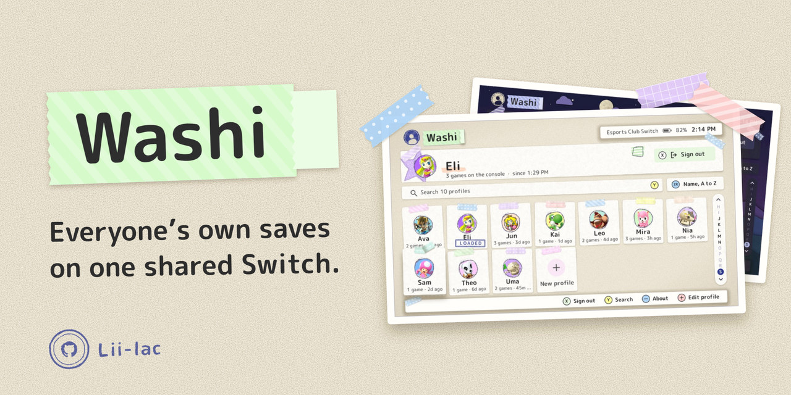
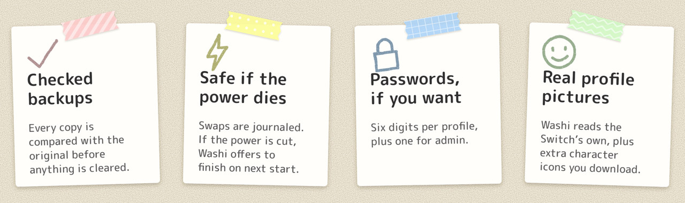
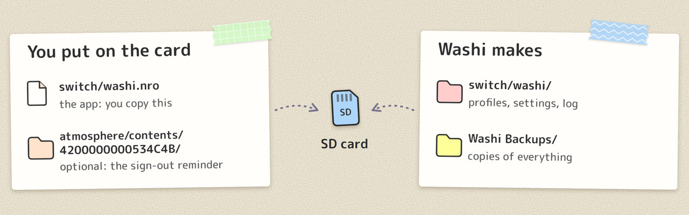
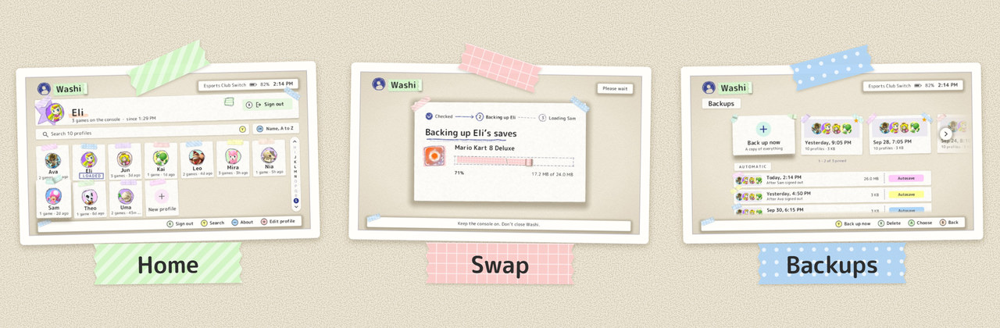
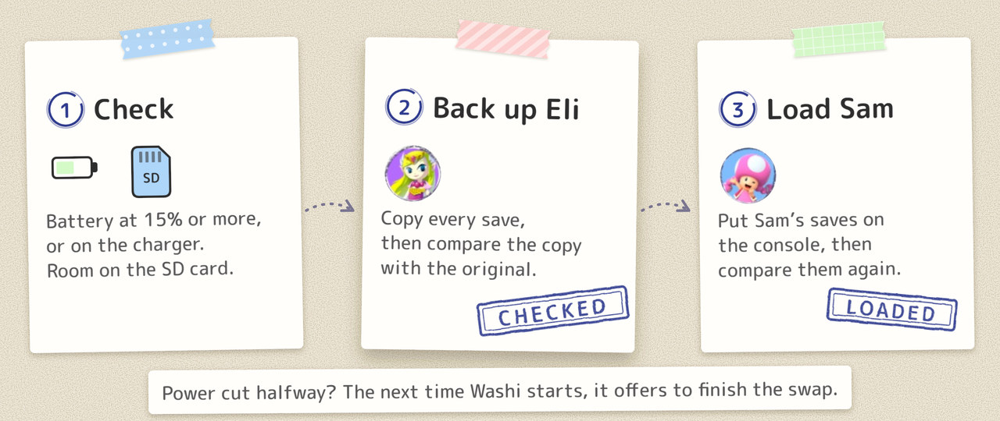
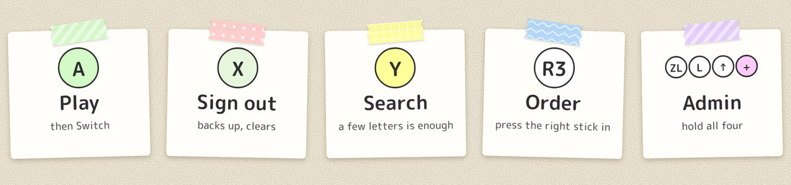
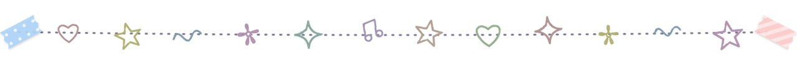

<h1 align="center">
  <picture>
    <source media="(prefers-color-scheme: dark)" srcset="docs/readme/dark/hero.jpg">
    
  </picture>
</h1>

**Washi** gives everyone on a shared Switch their own game saves, beyond the standard eight user limit. Pick your name, play, sign out. Washi backs you up and clears the console for the next person.

  <a href="#install"><picture><source media="(prefers-color-scheme: dark)" srcset="docs/readme/dark/nav-install.png"></picture></a>
  <a href="#using-it"><picture><source media="(prefers-color-scheme: dark)" srcset="docs/readme/dark/nav-using-it.png"></picture></a>
  <a href="#good-to-know"><picture><source media="(prefers-color-scheme: dark)" srcset="docs/readme/dark/nav-good-to-know.png"></picture></a>
  <a href="#docs"><picture><source media="(prefers-color-scheme: dark)" srcset="docs/readme/dark/nav-docs.png"></picture></a>

<picture>
  <source media="(prefers-color-scheme: dark)" srcset="docs/readme/dark/features.jpg">
  
</picture>

<picture>
  <source media="(prefers-color-scheme: dark)" srcset="docs/readme/dark/div-roll.png">
  
</picture>

### Install

You need custom firmware, the Homebrew Menu, and one regular user account that everyone plays on.

> [!WARNING]
> Back up your saves with JKSV before you open Washi for the first time. Washi checks every copy it makes, but keep one of your own.

1. Download `washi.nro` from the [latest release](https://github.com/Lii-lac/washi/releases/latest).
2. Put it at `/switch/washi.nro` on the SD card.
3. Open it from the Homebrew Menu (hold <kbd>R</kbd> while you launch a game).
4. Answer the first-run questions: have you backed up, which account is shared, and an admin password.
5. Press <kbd>A</kbd> on **New profile**, type a name and pick a picture.

When your card shows on the home screen and <kbd>A</kbd> asks **Play as …?**, it's working.

<picture>
  <source media="(prefers-color-scheme: dark)" srcset="docs/readme/dark/diagram-sd-card.jpg">
  
</picture>

You can also add a [Home-menu icon](docs/forwarder.md) and a [sign-out reminder](docs/reminder.md) that shows inside games (requires [Ultrahand](https://github.com/ppkantorski/Ultrahand-Overlay)).

<picture>
  <source media="(prefers-color-scheme: dark)" srcset="docs/readme/dark/div-sampler.png">
  
</picture>

### Using it

<picture>
  <source media="(prefers-color-scheme: dark)" srcset="docs/readme/dark/strip.jpg">
  
</picture>

Press <kbd>A</kbd> on your name, then **Switch**. Washi checks the battery and SD space, backs up whoever was loaded and loads you. Keep the console on until the bar finishes.

<picture>
  <source media="(prefers-color-scheme: dark)" srcset="docs/readme/dark/diagram-swap.jpg">
  
</picture>

Press <kbd>X</kbd> when you’re done. Washi backs you up, checks the copy and clears the console. If nobody is loaded, the console is in guest mode and nothing is kept. A guest who wants their saves can make a profile and tap **Keep it**.

<picture>
  <source media="(prefers-color-scheme: dark)" srcset="docs/readme/dark/keys.jpg">
  
</picture>

<picture>
  <source media="(prefers-color-scheme: dark)" srcset="docs/readme/dark/div-doodles.png">
  
</picture>

### Good to know

- Only one account’s saves are swapped. Device, cache and system saves are left alone, and an admin can mark a game as shared.
- An admin can mark a profile **read-only** (Admin, Profiles, the profile). It keeps its saves exactly as they are: what anyone plays as it is thrown away when they sign out or someone else loads, and its name and picture are locked. Good for a profile of finished saves.
- If someone starts a game without opening Washi, that play goes to whoever is still loaded. Tell people to sign out.
- If the account has Nintendo Switch Online cloud saves, turn off *Automatic Save-Data Download* in System Settings. Otherwise the console may pull a cloud copy over a swapped-in save.
- Custom firmware has risks, bans included. Washi doesn’t change them.
- Washi goes online only for GitHub (extra icons and the update check). Your saves never leave the console.

<picture>
  <source media="(prefers-color-scheme: dark)" srcset="docs/readme/dark/div-bunting.png">
  
</picture>

### Docs

- [Reference](docs/reference.md)
- [Profile pictures](docs/profile-pictures.md)
- [Contributing](CONTRIBUTING.md)

<picture>
  <source media="(prefers-color-scheme: dark)" srcset="docs/readme/dark/div-peel.png">
  
</picture>

### Licence

Free to use and change. If you build on it, what you make stays free and open too ([GPL-3.0-or-later](LICENSE)). Built with devkitPro, libnx, cJSON, stb and M PLUS Rounded 1c, each under its own licence (see [THIRD_PARTY_NOTICES.md](THIRD_PARTY_NOTICES.md)). Not affiliated with Nintendo. The profile pictures in the screenshots are theirs.
