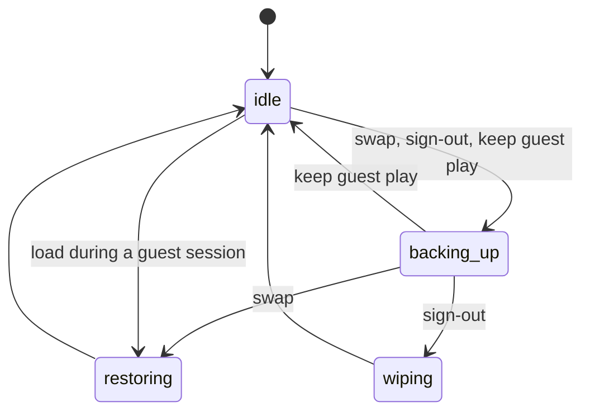

# How it works

The mental model behind Washi, and the few design decisions that aren't obvious, with the reasons. It is written for someone
who might fix a bug. File and function names point into [`source/`](../source); the [source map](building.md#source-map) says
what each file holds.

- [The model: check out, check in](#the-model-check-out-check-in)
- [What gets swapped](#what-gets-swapped)
- [A swap, step by step](#a-swap-step-by-step)
- [Sign-out and the guest session](#sign-out-and-the-guest-session)
- [Never losing a save](#never-losing-a-save)
- [Earlier saves and roll back](#earlier-saves-and-roll-back)
- [Backups of everything](#backups-of-everything)
- [The console's own profile](#the-consoles-own-profile)
- [The optional extras](#the-optional-extras)
- [Why the logic runs on a PC](#why-the-logic-runs-on-a-pc)
- [Drawing the interface](#drawing-the-interface)

## The model: check out, check in

The Switch allows eight user accounts, so real accounts can't give a club one save each. Instead everyone plays on one shared
account, and that account holds exactly one person's saves at a time: the **holder**, recorded in `state.json`.

- **Play as someone:** back up the account's saves into the holder's profile, check the copy, then put the new person's saves on
  the account. They are now the holder.
- **Sign out:** back up the holder's saves, check them, then empty the account's saves. Nobody is the holder; the console is in a
  **guest session** until someone picks their name.

Everything else (roll back, unclaimed saves, backups of everything) works on the folders on the SD card, never on a save that
hasn't been backed up.

## What gets swapped

Only **account saves** of the shared account (`FsSaveDataType_Account`, user space). Never device saves (one save for the whole
console: swapping those per person would be wrong), BCAT, cache, temporary or system saves, other accounts, or anything outside
Washi's own SD folder. Games marked **Shared** in Admin are left out too.

Loading profile B goes through every game that has a save on the account or a backup in B's profile:

| Account has a save | B has a backup | What happens |
|---|---|---|
| yes | yes | Empty the save, copy B's files in, commit, check. |
| yes | no | Empty the save and commit: B starts that game fresh. The old contents were already backed up. |
| no | yes | Create the save (sizes from the game's control data), then copy, commit, check. Not installed: skip with a warning; the backup stays. |
| no | no | Nothing. |

Saves are emptied, not deleted. The save stays registered with the system, and an empty save is what a game sees on its first
launch. Washi only ever creates saves; it never deletes one.

## A swap, step by step

`lk_swap_to` in `locker.c`:

1. **Check first, write nothing.** Refuse if the battery is under 15% and not charging. Open every save on the account once: a
   running game holds its save open, so this finds it before anything is written. Refuse if the SD card has less free space than
   1.2 × the saves.
2. **Journal:** write `phase: backing_up`, `from`, `to` into `state.json`.
3. **Back up** each game into `profiles/<holder>/staging-<time>/`, and compare each copy with the live save. Games that have
   nothing in their save are skipped. Games in the old backup that aren't on the account now (uninstalled, or marked shared later)
   are copied over from the old backup.
4. **Commit the backup by renaming:** `current/` becomes `history/<time>/`, then `staging-<time>/` becomes `current/`. If the new
   backup is identical to `current/`, the staging copy is thrown away instead, so idle sessions don't push real history out.
5. **Journal:** `phase: restoring`.
6. **Load** the new person's saves (the table above), committing as the save's journal fills, and compare each loaded save with
   its backup.
7. **Finish:** the new holder, `phase: idle`, and `loaded_at` (the time the "still you?" question and the reminder count from).

If the console is in a guest session, steps 2 to 4 are skipped: a guest's play is temporary and is not kept.

## Sign-out and the guest session

`lk_sign_out` backs the holder up exactly as above, writes `phase: wiping`, then empties every swapped save. Emptying destroys
data, so it checks first: just before each save is emptied, it is compared with the same game in the backup that was just made.
If they differ, the sign-out stops with that save untouched. Shared games and device saves are never cleared.

After a sign-out, `state.json` has `holder: unclaimed` and `wiped: 1`: a guest session. The home screen shows **Guest**, and the
next person who loads skips the backup, so the guest's play is thrown away.

**Why clear the console?** The original plan left the saves on the account after a sign-out. Then the next person to play
without opening the app would carry on in someone else's game. Clearing means a person's progress never stays on the console
after they leave, and anyone who skips the app starts fresh.

**Keeping a guest's play.** A guest who makes a profile is asked **Keep what you just played?** `lk_claim_guest` backs the console
up into the new profile (checked) and makes it the holder; nothing is cleared or loaded, because the console already holds that
play. Its journal says "backing up into this profile, then loading it", so after a power cut recovery backs up again and loads the
same backup, which leaves the console as it was.

**The first load.** Before the first sign-out, nobody knows where the console's saves came from. The first swap backs them up
into `unclaimed/<time>/` instead of throwing them away. Admin → **Unclaimed saves** can give them to a profile (as a backup: the
profile's current saves go into its history) or delete them. Changing the shared account resets this, for the same reason.

## Never losing a save

### Check before overwriting

Every copy is compared with its source before anything depends on it: same file names, same sizes, then the same CRC32 for each
file (`fsx_tree_equal`). A backup that doesn't match stops the swap before the account is touched. A loaded save that doesn't
match its backup is reported as a failure.

### The journal and recovery

`state.json` records the phase before each step starts. When the app opens and the phase isn't `idle`, it offers to finish:

| Interrupted while | What is true | What recovery does |
|---|---|---|
| `backing_up` | The account's saves haven't been touched. | Throw the half-made `staging-*` copy away and back up again. |
| `wiping` | The holder's backup was finished and checked. | Clear the console again (clearing twice is harmless). |
| `restoring` | The new person's backup is only ever read while loading. | Load it all again from the start. |

Every step can be repeated, so recovery is "do the phase again", never "work out how far it got". The PC tests prove it by
cutting the power at every counted call in eight operations, restarting, recovering, and comparing the result with an
uninterrupted run.

At startup `lk_startup` also heals a profile caught between its two renames: if `current/` is missing, the newest history entry
*is* the old `current/`, so it is renamed back.

### Writes that survive a power cut

The SD card's file system can't replace a file in one step. `config.json` and `state.json` are written to `<file>.tmp`, then the
old file is deleted, then the `.tmp` file is renamed into place (`fsx_write_atomic`). A reader that finds no file uses the `.tmp`
one, which is complete by then. A file that still can't be read is renamed `*.corrupt-<time>` and replaced with defaults, and the
app says so.

### Rename before delete

Anything that is removed is first renamed in one step, then deleted. A power cut in the middle then leaves a folder with a name
that says "half gone", which the app clears next time, never one that looks real but is missing files:

| What | Renamed to first |
|---|---|
| A deleted profile | `profiles/.trash/<id>-<time>/` (kept until deleted for good) |
| Deleted for good | `profiles/.trash/.gone-<name>/`, then removed |
| Unclaimed saves given away or deleted | `unclaimed/staging-gone-<name>/`, then removed |
| A new backup of everything | made as `<name>.partial/`, renamed when checked |
| A restore | each part copied to `<part>.restoring`, the current one moved to `<part>.replaced`, then renamed in |

New backups follow the same rule the other way round: they are built under a temporary name and only get their real name once
they have been checked.

### Commit before the save's journal fills

A save can only take so many uncommitted bytes. While loading, Washi commits after every file, and before a write would
pass a limit taken from the game's journal size (the journal size less 1 MB when it is over 2 MB, otherwise half of it). JKSV does
the same. This is what lets big saves load.

### Only the games a person played

A game whose save is empty (never played, or cleared) is not backed up, so a profile only lists games its owner played. When
that person's profile is loaded, those other games start fresh, which is right: they never played them.

### Read-only profiles

A profile can be marked read-only (`"readonly": 1` in its `profile.json`). Leaving it skips steps 2 to 4 of the swap, exactly as for a
guest, and a sign-out only clears the console: with no backup to compare with, the check "every save equals the holder's backup" is
turned off. The decision is written into the journal (`"discard"` in `state.json`) when the operation starts, so a power cut finishes
it the same way even if the mark is switched off meanwhile. A `profile.json` that exists but can't be read stops the operation instead
of guessing. Keeping guest play, roll back and giving unclaimed saves are refused for a read-only profile.

## Earlier saves and roll back

Each backup that changes something moves the old `current/` into `history/<time>/`, and only the newest 5 are kept (Admin →
**Storage** changes the number; **Delete older backups now** trims everyone at once). **Roll back** puts a history entry back as
`current/` (the current one goes into history too) for the next time that person loads. Deleting a profile moves it whole to
`profiles/.trash/`, so it can be restored with its history.

## Backups of everything

Admin → **Backups** copies all of `/switch/washi/` into `Washi Backups/mm-dd-yyyy--hh-mm/` at the root of the SD
card, built as `.partial` and checked before it gets its name (`lk_snapshot`). The first sign-out of each day makes one by itself,
after the sign-out has finished (so the person who just left is in it), and marks it with a `.auto` file holding their name. Only
the newest 4 automatic ones are kept; hand-made ones are never removed by the app.

**Restore** (`lk_snapshot_restore`) only runs with nobody loaded. It first makes a hand-made backup of how things are now. Then it
copies the backup's `profiles/`, `unclaimed/`, `system-profile/` and `config.json` beside the live ones and checks them; only
then does it swap them in with renames, and if one rename fails it puts the earlier ones back. `state.json` and the log are not
restored: they describe this console as it is now.

## The console's own profile

Off by default (Admin → **Console profile**). With it on, the shared account's own name and picture (what games and the Home menu
show) follow whoever is loaded, and go back when they sign out. It uses the profile editor of the system's account service
(`sysprofile.c`). Before the first change, the original name and picture are saved to `system-profile/`; if that can't be saved,
nothing is changed. The rest of the account's profile data is passed back unchanged. A failure here never stops a swap; it is only
reported.

The profile pictures are the console's own icons in the console's own order, so the icon id written to the account is the
picture's number plus one, and the background id is the colour's number. The 72 background colours were measured from the
console's own editor (`source/swatches.h`), so a colour here matches the console's.

## The optional extras

**The in-game reminder** is a separate background program (a sysmodule) that starts with the console. Every 30 seconds it reads
`state.json`, `config.json` and the loaded profile's name. While someone is loaded and the swap journal is idle, it drops a note
file for Ultrahand to show over the game: first after the **Sign-out reminder** time, then again and again for as long as the same person stays loaded (as often as that time, but at least every hour). It writes nothing else.
The app and the reminder only talk through files: the app's test button writes `reminder-test`, and the reminder (which looks every
5 seconds) answers in `reminder-test.done`. See [In-game reminder](reminder.md).

**The forwarder** is a tiny installed title whose only job is to launch `sdmc:/switch/washi.nro`. Updating the app never
needs a new forwarder. See [Home-menu forwarder](forwarder.md).

## Why the logic runs on a PC

`locker.c` (the swap, sign-out and recovery logic) talks to the console only through `backend.h`: list saves, mount, create,
commit, unmount, game names, battery, free space. File copying inside a save is plain C file I/O on `save:/`. On the console,
`backend_nx.c` implements it with libnx. In the tests, `test/backend_host.c` is a fake console where each save is a folder. The
fake enforces journal limits, drops writes that weren't committed, and can "cut the power" at any counted call (`cp()` in
`locker.c` marks those points).

The whole interface works the same way: `app.c` talks to the screen, buttons, clock and keyboard through `platform.h`, so the PC
can drive every screen with scripted presses and save each frame as a PNG.

## Drawing the interface

A small software renderer draws into the 1280×720 framebuffer (no SDL or OpenGL), so the same code draws the Switch screen and the
PC screenshots. The look is Washi: paper cards and slips pinned to a cream board with washi tape. Whatever has the focus is the one
that is unstuck: it lifts, its tape peels, a ghost patch stays where it lay, and it wiggles. The tape is see-through and lightly
pressed: a little haze, a corner that tents up, a few soft creases, a faint shadow, and nothing that wraps hard round the card's edge.
Everything is baked once into small
sprites (`source/gfx/paper.c`) and a screen paints only the rectangles that changed.

When the app is busy between two screens (reading the SD card, baking a page's pictures) for more than about a third of a second,
a taped scrap comes down at the top and a crayon doodles little symbols on it, rubbing each out before the next (`source/ui_wait.c`).
The app has one thread, so the scrap moves only when the work gives it a moment: the long loops (making a sprite or a surface, walking
a folder, the crayon filter) call `gfx_pump` and `fsx_pump`. When the work is over the doodle is rubbed out, the tape is peeled off, the scrap
is whisked away, and what was under it is put back exactly. The look is cream on every console theme for
now; a dark one needs its own design. The fonts are M PLUS Rounded 1c,
with the console's own font for letters they lack (kanji, Korean). Games from firmware 21 on keep their names compressed in their
control data; `nacp_name.c` reads them, because the libnx version used here doesn't.

