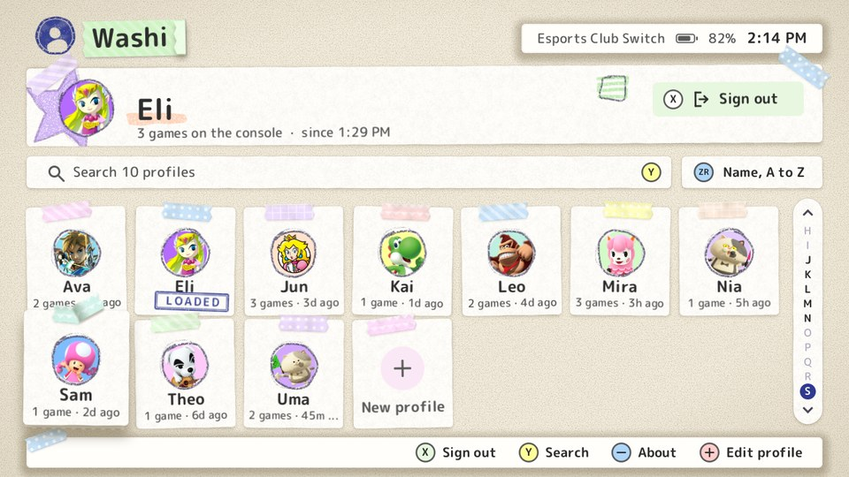
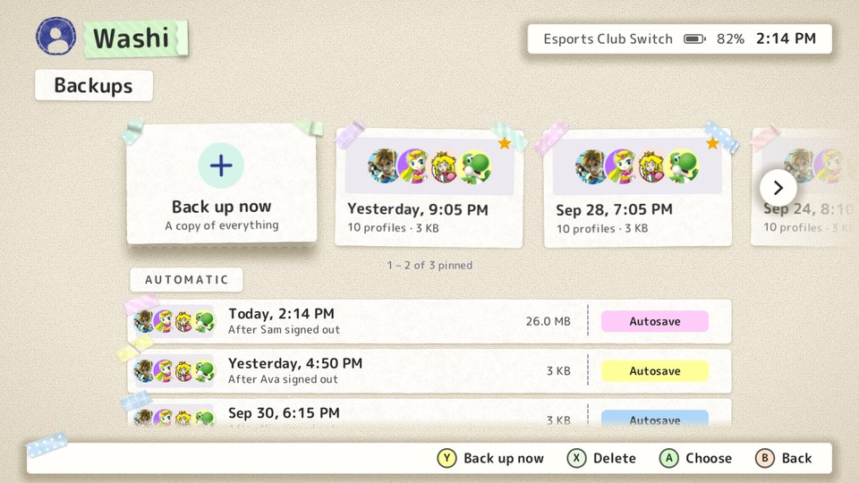

# Reference

Every screen, button, setting and limit in Washi, for looking things up. It describes version 1.0.0. For why things work
the way they do, see [How it works](how-it-works.md).

- [Words used here](#words-used-here)
- [Buttons on every screen](#buttons-on-every-screen)
- [Home screen](#home-screen)
- [Playing as someone](#playing-as-someone)
- [Signing out and leaving](#signing-out-and-leaving)
- [New profile](#new-profile)
- [Edit profile and Edit Icon](#edit-profile-and-edit-icon)
- [Password pad and keyboard](#password-pad-and-keyboard)
- ["Is this still you?"](#is-this-still-you)
- [Admin](#admin)
- [After an interruption](#after-an-interruption)
- [Refusals and warnings](#refusals-and-warnings)
- [Files on the SD card](#files-on-the-sd-card)
- [Older installs (Save Locker)](#older-installs-save-locker)
- [config.json](#configjson)
- [Limits](#limits)
- [Before the club uses it](#before-the-club-uses-it)
- [Known limitations](#known-limitations)
- [Not yet confirmed on the console](#not-yet-confirmed-on-the-console)

## Words used here

| Word | Meaning |
|---|---|
| **Shared account** | The one console user account whose saves Washi swaps (Admin → Console → **Account**). |
| **Profile** | One person in Washi: a name, a picture, an optional password and NetID, and their saves on the SD card. |
| **Loaded** | The profile whose saves are on the shared account right now. Only one at a time. |
| **Guest** | Nobody is loaded and the console has been cleared by a sign-out. Anything played now is temporary. |
| **Nobody** | Nobody is loaded and the console has not been cleared yet (before the first sign-out). |
| **Shared game** | A game left out of swapping: everyone uses the same save. |
| **Device save** | A game that keeps one save for the whole console, not one per account. Always shared. |
| **Earlier saves** | A profile's previous sets of saves, kept for **Roll back**. |
| **Unclaimed saves** | What was on the console the first time anyone loaded with Washi. |
| **Backup** (Admin → **Backups**) | A copy of everything Washi keeps, in `Washi Backups/` on the SD card. |

## Buttons on every screen

| Input | What it does |
|---|---|
| `A` | Choose, open, confirm. |
| `B` | Back, cancel. On the password pad and keyboard it deletes the last digit or letter first. |
| D-pad or left stick | Move. In menus and lists, one press past the end goes round to the other end; holding stops at the end. The picture and colour grids go round every row and column (Left off a row's start goes to its end, Up off the top to the bottom of the column), pressed or held. The Home grid, the pad and the keyboard don't go round. |
| A press toward nothing | The item in focus leans that way and springs back. Nothing else happens. |
| Touch | Tap anything you could press, including the button prompts along the bottom. Drag to scroll lists, grids and text. |

When a screen is slow to open, a taped paper scrap with crayon doodles drops in at the top after about a third of a second. It
goes when the screen is ready: the doodle is rubbed out, the tape peels, and the new screen fades in.

## Home screen



From top to bottom: the logo, battery, clock and account name; the loaded profile's card with a **Sign out** button; a search bar
with the order chip beside it; then a grid of everyone, 7 across, with **New profile** as the last tile.

| Input | What it does |
|---|---|
| `A` on a tile | Play as that person. See [Playing as someone](#playing-as-someone). |
| `A` on **New profile** | [Make a profile](#new-profile). |
| `X` | [Sign out](#signing-out-and-leaving) the loaded profile. |
| `Y` | Search. |
| `R3` (press the right stick in) | Open the order menu. Every order menu in Washi opens with it. |
| `+` | [Edit](#edit-profile-and-edit-icon) the loaded profile (picture, name, NetID). Nobody loaded: the profile that is selected, after its password if it has one, and nobody gets loaded by it. |
| `-` | About. A tap on the logo does the same. While a search narrows the grid, `-` clears it instead (the bar shows the `-` button at its end). |
| `L` / `R` | In name order: jump to the previous or next letter. In other orders: one row up or down. Works from anywhere on Home (the focus goes to the cards); past the rows showing, the cards glide there. |
| Up from the first row | To the search bar or the chip (whichever is above), then to the loaded card or its **Sign out** button. |
| `A` on the loaded card | Edit that profile. With a guest: "Pick your name below to keep what you play." |
| `B` | Nothing: Home is where Washi starts. Close it with the console's HOME button, like any game (see [Signing out and leaving](#signing-out-and-leaving)). |
| `ZL` + `L` + D-pad up + `+` | Admin. Hold the first three, then press `+`. |
| `ZL` + `ZR` + `A` on a tile | Admin: [pin](#pinned-profiles) the profile, or unpin it. Hold both triggers, then press `A`. |

<a id="pinned-profiles"></a>**Pinned profiles.** An admin can pin a profile (`ZL` + `ZR` + `A` on its card, then the admin password; the same again
unpins it). A pinned card comes first in every order, the first one pinned first; a search ignores pins. It is held to the board by a
push pin in the colour its tape would have had, instead of tape, and lies a little straighter. When the card has the focus it lifts as
usual and the pin rises out of it; when the focus leaves, the pin goes home. Pinning plays the strip coming off and the pin pushed in;
unpinning, the pin pulled out and a new strip stuck on. The pin is kept in the profile, so it survives a restart.

The card under the top bar shows who is loaded, how many games are on the console and since when. With a guest it shows
**Guest** with the guest picture and "nothing played right now is saved".

**Order** (`R3` or the chip; remembered after restart). A glassine sleeve slides out from under the chip with a sticker for each
of the other orders in it; Up and Down bring the next one out of its mouth, `A` peels it off and sticks it on the chip, and `B`, `R3`
or a tap closes it unchanged. The chip wears the sticker of the order in use, printed a little soft, focused or not. A new
order shuffles the grid: the tiles are carried to their new places (a search does the same). The Extra icons page and the Picture
page have the same sleeve for their own orders, and their rows and cards shuffle the same way.

| Order | Sorts by |
|---|---|
| Recently played (default) | Last played first; whoever is loaded counts as now; never played last. |
| Name, A to Z | Name. Shows an A to Z strip; tap a letter to jump to it. |
| Newest first | When the profile was made. |
| Most games | Number of games with saves. |

**Search** (`Y` or the bar) narrows the grid to the matches, best first. Case and spaces in the search are ignored. The bar then
shows the search and "N of M"; `-` or a tap on the bar's `-` mark shows everyone again. Loading someone or making a profile also clears it.

| Rank | A profile matches when |
|---|---|
| 1 | Its NetID starts with the search (the NetID itself is never shown). |
| 2 | Its name starts with it. |
| 3 | A later word of the name starts with it. |
| 4 | The name contains it. |
| 5 | The search's letters appear in the name in that order ("arn" finds a name with a, then r, then n). |

## Playing as someone

1. Pick a tile and press `A` (or tap it).
2. If the profile has a password, enter it.
3. **Play as *name*?** shows their number of games, when they last played, and what happens to the console's current saves:
   - someone loaded: "*their* saves are backed up first";
   - **Nobody**: "What's on the console is backed up first" (kept in [Unclaimed saves](#unclaimed-saves));
   - **Guest**: "Guest progress isn't kept."
4. **Switch** starts it. A progress screen shows each step and one line per game.
5. **You're playing as *name*** confirms it, with any warnings (for example a game that isn't installed was skipped).

Picking the profile that is already loaded only says so.

## Signing out and leaving

**Sign out** (`X`, or the **Sign out** button on the card) backs up the loaded profile, checks every save against that backup
again, then clears every swapped save on the console. Home then shows **Guest**. The first sign-out of each day also makes an
[automatic backup](#backups) of everything, after the sign-out is done; if that backup fails, the sign-out still stands.

**Leaving**: Washi is closed with the console's HOME button (then close the software), like any game. Whoever is loaded stays
loaded: anyone who plays next plays into their saves, so sign out first when you are done (the [sign-out reminder](#sign-out-reminder)
says so too).

## New profile

The steps, in order. Nothing is made until `A` on **OK** in the last step; `B` there drops it all.

| Step | Notes |
|---|---|
| **What's your name?** | At least one letter. |
| **NetID** (optional) | Three letters and four digits, like `abc1234`, any case. One profile per NetID. Leave it empty to skip. |
| **Add a 6-digit password?** | **Add one** asks for it twice; **Skip** makes none (an admin can add one later). |
| **Edit Icon** | Starts on a random picture nobody else has, on a random light background. |

If the console holds a guest's play, the last question is **Keep what you just played?** (with the number of games).
**Keep it** saves that play into the new profile, checked, and loads it. **Start fresh** makes the profile without loading it;
the guest's play is thrown away when the next person loads. A guest who played nothing is not asked.

## Edit profile and Edit Icon

**Edit profile** (`+` on the home screen: the loaded profile, or with nobody loaded the one in focus, after its password) has three rows: **Picture and background**, **Name** and
**NetID**. The NetID row only says whether one is set. A NetID that another profile has is refused.

**Edit Icon** works like the console's own editor:

| Row | What it opens | Controls |
|---|---|---|
| **Picture** | A strip of cards with a sheet of pictures under the one in focus: first **Console** (the letter, then the Switch's profile icons grouped by series), then each game of [Extra icons](profile-pictures.md#extra-icons) on the SD card. The preview follows the cursor. | D-pad in the sheet (it wraps round), `L` / `R` one card, `ZL` / `ZR` five, `R3` order of the games, `A` keep, `B` back unchanged, `X` no picture (the first letter of the name) |
| **Background** | The console's 72 background colours, 6 across. | `A` keep, `B` back unchanged |
| **OK** | Saves (or, for a new profile, makes it). | `B` cancels |

If the loaded profile changes its name or picture and [Console profile](#console-profile) is on, the console's own profile is
updated too.

## Password pad and keyboard

| Screen | Controls |
|---|---|
| Password pad (6 digits) | D-pad and `A` type, or tap. It submits on the sixth digit. `X` deletes a digit. `B` deletes a digit, and leaves when there are none. |
| Built-in keyboard | `A` type, `X` delete, `Y` shift, `+` done, `B` delete a letter (leaves when empty). |

Text is typed with the console's own keyboard when it opens. When it doesn't (it may not, in applet mode), the built-in keyboard
appears instead. To always use the built-in one, set `"builtin_keyboard": 1` in [config.json](#configjson).

A wrong password says how many tries are left. After 5 wrong tries the app makes you wait 30 seconds, and 30 seconds more after
each further miss. The count starts again when the app restarts.

## "Is this still you?"

When the app opens and the loaded profile has been loaded longer than the [Sign-out reminder](#sign-out-reminder) time (3 hours by
default), it asks **Is this still *name*?**

| Choice | What happens |
|---|---|
| **Yes, still me** | Starts the count again. |
| **Sign out** | Signs them out (backs up and clears the console). |

## Admin

Open it with `ZL` + `L` + D-pad up + `+` on the home screen, then the admin password. `+` pressed while `ZL` is held does not
open **Edit profile**.


The admin page is laid out like System Settings: sections on the left, their rows on the right, each row showing how things stand.
D-pad up and down picks a section; `A` or right goes into its rows; `B` or left comes back; `B` on the sections leaves.

| Section | Row | What it is for |
|---|---|---|
| People | [Profiles](#profiles) | Rename, NetID, password, picture, roll back, delete. |
| People | [Deleted profiles](#deleted-profiles) | Bring a deleted profile back, or delete it for good. |
| People | **Admin password** | Choose a new 6-digit admin password (entered twice). |
| Games and saves | [Shared games](#shared-games) | Choose games that everyone shares. |
| Games and saves | [Storage](#storage) | SD card space, who uses the most, how many earlier saves to keep. |
| Games and saves | [Unclaimed saves](#unclaimed-saves) | Give the console's first saves to a profile, or delete them. |
| Games and saves | [Backups](#backups) | Back up everything; restore or delete a backup. |
| Console | [Account](#account) | Which console account is swapped. |
| Console | [Console profile](#console-profile) | Show the player's name and picture on the console itself. Off by default. |
| Console | [Sign-out reminder](#sign-out-reminder) | When to ask "Is this still you?", and when the in-game note comes. |
| Console | **Test the in-game reminder** | See [In-game reminder](reminder.md#check-that-it-works). |
| This app | **Appearance** | **Theme**: Follow the console (cream paper, or Paper night while the console is in its dark theme), Paper, or Paper night. **Clock**: 12-hour or 24-hour. |
| This app | **Activity log** | The last 300 lines of this start's log, and a list of the earlier starts to open, by when each start was in the console's own time (Washi keeps a file for every start for two weeks). The times inside a log are UTC. |
| This app | [Extra icons](profile-pictures.md#extra-icons) | Download character pictures from Nintendo Switch Online and the games (one game at a time, or every game) from the community collection, or remove them. They then show in Edit Icon's Picture page, a card for each game after the console's own. |
| This app | **Check for updates** | Asks GitHub for the newest Washi. If there is one, it downloads it and checks it, puts it in place of the running copy (the old copy is kept, so the page can bring it back), then Washi closes and opens again. Nobody's saves change. |
| This app | **About** | What Washi is, the club's Discord QR code (blocks coloured in with wax crayon, on a taped print), and, small along the bottom, the maker's GitHub mark and name and the version. |

The summary at the top shows the number of profiles, the free space and the version.

### Profiles

A list of every profile (the loaded one is marked **Loaded**). `A` opens a profile's page:

| Row | Notes |
|---|---|
| **Rename** | At least one letter. |
| **NetID** | Shown here, to the admin only. A NetID another profile has is refused, and the admin is told whose it is. |
| **Remove NetID** | Only when one is set. |
| **Add a password** / **Change password** | Six digits, entered twice. |
| **Remove password** | Asks first. |
| **Picture and background** | Opens [Edit Icon](#edit-profile-and-edit-icon). |
| **Roll back to earlier saves** | Pick an earlier set (newest first). Their current saves are kept in the list too. It loads the next time they pick their name. Not while they are loaded. |
| **Delete profile** | Moves the profile, saves and all, to [Deleted profiles](#deleted-profiles). Not while they are loaded. |

### Deleted profiles

Deleted profiles, newest first, with when they were deleted and how many games they hold.

| Input | What it does |
|---|---|
| `A` | **Restore**: the profile comes back with its saves and earlier saves. If its NetID now belongs to someone else, it comes back without one and says so. |
| `X` | **Delete for good**, after asking. X acts when you let go of it. |
| `ZR` + `X` | **Delete all**, after a 3-second wait: hold `X`, press `ZR`, let go of both. The red **Delete all** button stays dim for 3 seconds and `A` does nothing until it lights up. `B` cancels at any time. |
| `B` | Back. |

A profile whose `profile.json` is damaged is listed dimmed and can't be restored; its folder stays in `profiles/.trash/`.

### Shared games

Every game with a save on the shared account. `A` switches a game between **kept per person** and **shared by everyone**. A
shared game is never swapped, so everyone plays the same save. Games whose save belongs to the whole console are listed as
**always shared** and can't be changed.

### Storage

| Part | What it shows or does |
|---|---|
| SD card | Free space and card size. |
| **Saves** bar | All save data, one part per profile in that profile's colour. Saves in no profile (deleted profiles and unclaimed saves) are the grey part at the end, drawn at most a quarter of the bar; the real sizes are written under it. |
| Profiles | The five that use the most. With more than five profiles, the last row is "N others", which opens **Everyone's saves** (everyone, largest first). `A` on a profile opens its page. |
| **Backups kept per profile** | How many earlier saves each profile keeps: 1, 2, 3, 5 (default) or 10. Older ones go at that profile's next backup. |
| **Delete older backups now** | Deletes everyone's earlier saves beyond that number at once. It says how much it frees and asks first. Nobody's current saves change. |

The page reads every folder on the way in, so it can take a moment with many profiles.

### Unclaimed saves

What the console held the first time anyone loaded with Washi, newest first, with the date, the games and the size. `A` on
one offers:

| Choice | What happens |
|---|---|
| **Give to a profile** | Pick a profile (not the loaded one). These saves become theirs. Their current saves go to **Roll back**, and their games that aren't in these stay as they are. It loads the next time they pick their name. |
| **Delete** | Deletes them for good, after asking. |

### Backups



A backup is a checked copy of all of `/switch/washi/` in `Washi Backups/mm-dd-yyyy--hh-mm/` at the root of the SD
card (with `-02` and so on if the name is taken).

- **Back up now** is the first tile. Backups made by hand are starred tiles beside it, in one row; three show in full and the next
  peeks in at the edge.
- **Automatic** backups are rows under their own heading, each titled "After *name* signed out". One is made on the first sign-out
  of each day, and only the newest 4 are kept. Backups made by hand are never deleted by the app.
- Each backup shows the pictures of up to four people in it.

| Input | What it does |
|---|---|
| D-pad left / right, `L` / `R` | One tile along. |
| `ZL` / `ZR` | Two tiles along. |
| D-pad up / down | Between the tiles and the automatic rows. |
| `Y` | Jump to **Back up now**. |
| `X` on a backup | **Delete this backup?** (asks first). |
| `A` | **Back up now**, or open a backup: **Restore this backup** or **Delete this backup**. |
| `B` | Back. |
| Touch | Drag the row sideways; flick it and it slows to a stop on a tile. Tap a tile that shows in full to open it; tap the one at the edge, or a round `<` `>` button, to bring it to the middle. |

**Back up now** says how big the copy will be. While someone is loaded, their latest play is only in a backup once they sign out.

**Restore** works only with nobody loaded. It first makes a backup of how things are now (a hand-made one, so it stays), then puts
back the backup's profiles, unclaimed saves, console-profile originals and settings. Who is loaded, the swap journal and the log
stay as they are.

### Account

The console's user accounts; the one in use is marked **In use**. Choosing another asks first, and is refused while someone is
loaded.

### Console profile

Off by default. With it on, the shared account's own profile (what games and the Home menu show) takes the loaded player's name
and picture, and goes back to the original when they sign out.

| Row | What it does |
|---|---|
| **Check it works** | Reads the account's profile and changes nothing. Shows its name and icon numbers, or "Not available". |
| **Show the player's name** | On or off. Turning it on asks first. |
| **Show the player's picture** | On or off. The picture is drawn on the profile's background colour. |
| **Guest picture** | What the account shows while nobody is loaded. |
| **Update it now** | Applies it for whoever is loaded (or the guest picture). |
| **Last update** | What happened the last time. |
| **Put the original back** | Restores the name and picture from before the first change. Shown once an original has been saved. |

The original name and picture are saved to `system-profile/` before the first change, and nothing is changed if they can't be
saved. The Home menu's own corner icon may keep the old name and picture until a game or the profile page is opened.

### Sign-out reminder

Two wheels, hours (0 to 12) and minutes (00, 15, 30, 45). The default is 3 hours. 0:00 or `Y` (**Turn off**) turns it off. Any setting shorter than an hour repeats as often as it says; longer ones repeat every hour after the first.

| Input | What it does |
|---|---|
| D-pad up / down | Turn the wheel that is lifted (hold to keep turning; it goes round). Each value is a paper slip. |
| D-pad left / right | The other wheel. |
| `A` | OK: use this time. |
| `B` | Cancel: leave it as it was. |
| `Y` | Turn off. |
| Touch | Drag a wheel; flick it to spin; tap a value above or below to bring it to the middle. |

The same time sets when the [in-game reminder](reminder.md) sends its first note.

## After an interruption

If a swap or sign-out stopped part-way (power cut, crash), the app says **The last swap stopped. Nothing is lost. Finish it
now?** when it next opens.

| Choice | What happens |
|---|---|
| **Finish now** | Finishes the job, then says **Done**. The right person is loaded and nothing is missing. |
| **Later** | Goes to the home screen. The next swap or sign-out asks again first. |

## Refusals and warnings

| Situation | What you see | What to do |
|---|---|---|
| A game is running | "Couldn't open *game*'s save. Close the game first." Nothing is changed. | Press `HOME`, close the game with `X`, try again. |
| Battery under 15% and not charging | "Battery is at *N*%. Plug in the charger." | Plug it in. |
| Not enough space | "Not enough free space on the SD card (*N* MB needed)." | Free space (see [Storage](#storage)). |
| A backup didn't match | "The backup of *game* didn't match. Nothing was changed." | Try again; check the SD card. |
| Clearing found a save that wasn't backed up | "The backup of *game* wasn't complete, so nothing was cleared." | Try signing out again. |
| A game in a profile isn't installed | A warning after the swap: "*game* isn't installed; skipped." Its save stays in the profile. | Install it; the next swap loads it. |
| Someone is loaded | "Sign out first" (roll back, delete, restore, change account). | Sign them out. |
| A settings file was damaged | "A settings file was damaged". It is renamed `*.corrupt-<time>` and defaults are used. | Check the settings in Admin. |

## Files on the SD card

```
sdmc:/
  switch/
    washi.nro
    washi/                    everything Washi keeps
      config.json                   settings (below)
      state.json                    who is loaded, and the swap journal
      logs/                         the activity log, a file for every start (named by its date and time, UTC); the ones older than 14 days are deleted
      profiles/<id>/                <id> = the name in lower case + 4 hex digits
        profile.json                name, password hash, picture, NetID, dates
        current/<TITLE ID>/         the saves, exactly as in each game's save
        history/<time>/<TITLE ID>/  earlier saves (time in UTC, YYYYMMDD-HHMMSS)
      profiles/.trash/<id>-<time>/  deleted profiles
      unclaimed/<time>/<TITLE ID>/  the console's saves from the first load
      system-profile/               the console profile's original name and picture
  Washi Backups/
    mm-dd-yyyy--hh-mm/              a copy of switch/washi/ (".auto" inside: automatic)
```

Folders named `staging-*`, `*.partial`, `*.restoring`, `*.replaced` or `.gone-*` are half-finished work. The app clears them
itself; leave them alone. The optional extras add their own files: see [forwarder](forwarder.md) and [reminder](reminder.md).

## Older installs (Save Locker)

Washi was called Save Locker before. The first time the renamed app starts, it renames the old folders on the SD card. Nothing
is copied or merged, so profiles, settings and backups come over as they were:

| Old | New | When |
|---|---|---|
| `/switch/save-locker/` | `/switch/washi/` | Only if `/switch/washi/` doesn't exist yet. |
| `Save Locker Backups/` | `Washi Backups/` | Only if `Washi Backups/` doesn't exist yet. |

If the new name is already taken, the old folder is left where it is. Some things are not moved:

- **The old app file.** Delete `/switch/save-locker.nro` after copying `washi.nro` to `/switch/`.
- **An old forwarder.** It looks for `/switch/save-locker.nro`. Replace it: see [the forwarder page](forwarder.md#install).
- **The in-game reminder** reads `/switch/washi/`, so it shows nothing until the renamed app has been opened once. It has the same
  program ID as before: copy the new `exefs.nsp` over the old one. When it next writes a note, it also removes any the old name left in Ultrahand's folder.

The rename is tested on the PC only ([`sc_adopt_names`](../test/app_host.c)); it has not been tried on a console.

## config.json

Everything here is set from the app; editing by hand is only needed for `builtin_keyboard`.

| Key | Default | Meaning | Set in |
|---|---|---|---|
| `target_uid` | (chosen at first run) | The shared account. | Admin → **Account** |
| `excluded_titles` | `[]` | Shared games, as 16-digit hex title IDs. | Admin → **Shared games** |
| `admin_pin_hash`, `admin_pin_salt` | (set at first run) | The admin password, salted and hashed. | Admin → **Admin password** |
| `history_keep` | `5` | Earlier saves kept per profile (1 to 50 by hand). | Admin → **Storage** |
| `builtin_keyboard` | `0` | `1` = never try the console's keyboard. | by hand |
| `theme` | `"auto"` | `"auto"`, `"light"` or `"dark"`. | Admin → **Appearance** |
| `clock24` | `0` | `1` = 24-hour clock. | Admin → **Appearance** |
| `sort_mode` | `0` | Home order: 0 recently played, 1 name, 2 newest, 3 most games. | Home → `R3` |
| `remind_minutes` | `180` | Sign-out reminder in minutes; `0` = off. | Admin → **Sign-out reminder** |
| `remind_restore` | `-1` | Left by the old "real one, in a minute" test, which is gone: if a config has it set, the usual reminder is put back when the app opens. Nothing writes it now; `-1` = none. | (nothing) |
| `sync_name`, `sync_picture` | `0` | Console profile shows the player's name / picture. | Admin → **Console profile** |
| `guest_picture`, `guest_swatch` | `111`, `43` | The guest picture and its background. | Admin → **Console profile** → **Guest picture** |

## Limits

| What | Limit |
|---|---|
| Profiles | No fixed number; SD card space. |
| Name | Up to 39 bytes (fewer letters outside plain ASCII); at least one letter. |
| Passwords (profile and admin) | Exactly 6 digits. |
| Wrong password tries | 5, then a 30-second wait (30 s more per further miss). |
| NetID | Three letters and four digits; one profile each. |
| Games on the shared account | 1,024. |
| Shared games | 64. |
| Earlier saves per profile | 1, 2, 3, 5 or 10 from Storage (1 to 50 in `config.json`); 5 by default. |
| Automatic backups | One a day (the first sign-out), newest 4 kept. |
| Battery for a swap or sign-out | 15%, or plugged in. |
| Free space for a swap or sign-out | 1.2 × the size of the saves on the console. |
| Free space for **Back up now** | 1.2 × the size of `/switch/washi/`, plus 8 MB. |
| Sign-out reminder | 0:15 to 12:45 in 15-minute steps, or off. 3 hours by default. |
| Log | A file for every start, 1 MB at most each, kept for 14 days. The Activity log shows the last 300 lines of one. |
| Accounts listed | 8. |
| Screen | Drawn at 1280×720. |

## Before the club uses it

- **Cloud saves.** If the shared account has Nintendo Switch Online save backup on, turn off **Automatic Save-Data Download**
  (System Settings → Data Management → Save Data Cloud). Otherwise the console may offer to pull a cloud copy over a swapped-in
  save.
- **Internet.** Washi goes online only for [Extra icons](profile-pictures.md#extra-icons) (downloaded from GitHub, and only when
  asked) and [Check for updates](#admin) (GitHub's releases). Both send GitHub a plain request with Washi's name and version;
  neither sends anything about your profiles or saves.
- **sysMMC or emuMMC.** Running homebrew on the console's normal system (sysMMC) and going online risks a ban, and the console is
  the club's. The usual answer is custom firmware on an emuMMC that stays offline, with the clean system booted for online play.
  Saves on the emuMMC are separate from the sysMMC's, so choose before people start building saves: moving them later is extra
  work.

## Known limitations

- **One person's saves at a time.** Only the shared account's own saves are swapped. Games with one save per console, and
  other accounts, are never touched.
- **Playing without signing out plays into the loaded person's saves.** Software can't stop it. The "Is this still you?" question,
  the [in-game reminder](reminder.md) and **Roll back** are the safety nets.
- **Guest play is thrown away** when the next person loads, unless the guest makes a profile straight away and keeps it.
- **Close the game before swapping.** A running game holds its save open; the swap is refused and nothing changes.
- **A game that isn't installed** is skipped when loading; its save stays in the profile for later.
- **Applet mode** (the Homebrew Menu opened from the Album) may not offer the console's keyboard; the built-in one appears instead.
- **The times inside an Activity log are UTC** (the list of starts uses the console's own time).
- **The screen is drawn at 1280×720**; docked, the console scales it up.
- **A backup made while someone is loaded** doesn't have their latest play until they sign out.
- **Some deletes can't be undone:** **Delete for good**, **Delete all**, deleting unclaimed saves, deleting a backup, and
  **Delete older backups now**. Deleting a profile can be undone (it goes to [Deleted profiles](#deleted-profiles)).
- **The Home menu's corner icon** may show the old name and picture after a [console profile](#console-profile) change until a
  game or the profile page is opened.

## Not yet confirmed on the console

The swap logic and every screen are tested on a PC (see [Building and testing](building.md#run-the-pc-tests)). These have not
been confirmed on a real console as of 1.0.0:

- How the **Backups** row moves and its touch control (new in 1.6.0 and 1.6.1), and the frame rate while a finger drags it.
- Every page of the Washi look except Home, the admin hub, About, Edit Icon and the lists that were seen in captures; and the stamp, the crayon icons and
  all the sounds (the PC only checks that each sound is asked for at the right moment; nobody has heard them on the console).
- The lightly pressed tape on every page, the "still working" scrap (how smoothly it moves while the app is busy, and how long its ending
  feels) and the button press without the warping seen in a captured video.
- The console's real frame rate in general; it has not been measured.
- Recovery after a real power cut. The PC tests cut the power at every step, but it has not been tried on the console.

[TESTING.md](../TESTING.md) is the checklist for trying a build on the console.
